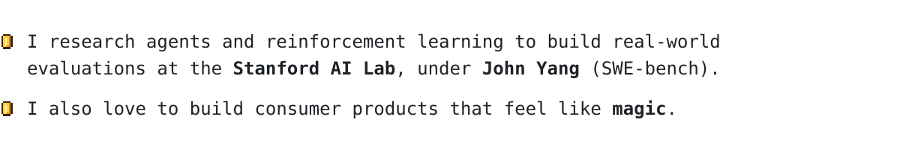

<picture>
  <source media="(prefers-color-scheme: dark)" srcset="https://raw.githubusercontent.com/aryansid/aryansid/output/night.svg">
  
</picture>
<picture>
  <source media="(prefers-color-scheme: dark)" srcset="https://raw.githubusercontent.com/aryansid/aryansid/output/bio-night.svg">
  
</picture>

Current research: [CodeClash](https://codeclash.ai/) &nbsp;·&nbsp; [x.com/Ar_boian](https://x.com/Ar_boian)
